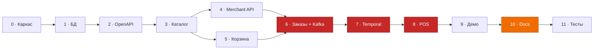

# План реализации — Авито.Кухня

> Этот документ — рабочий план и одновременно тот самый «промпт (plan)», который задание
> просит приложить. Он писался **до** кода: сначала сценарии и контракты, потом реализация.
> Проектные решения и их обоснование — в [`docs/DESIGN.md`](docs/DESIGN.md).

---

## Принципы, которым подчинён план

1. **Contract-first.** Сначала OpenAPI и схема БД, потом код. Типы и серверные интерфейсы
   генерируются из спецификации — спецификация не может разойтись с реализацией.
2. **Каждый этап заканчивается работающим состоянием.** После любого этапа
   `docker compose up` поднимается и `make lint test` зелёный. Нет этапа «тут ничего
   не работает, зато потом заработает всё».
3. **Демо раньше полировки.** Сквозной сценарий «заказ прошёл от клиента до POS и обратно»
   должен заработать на этапе 8 из 11 — остаётся запас на документацию и тесты.
4. **Никакой инфраструктуры без задачи.** Kafka и Temporal вводятся в тот этап, где
   появляется проблема, которую они решают, а не «на всякий случай в начале».
   Задание их не требует вовсе — почему они всё же здесь, честно разобрано
   в вопросе №10 к защите.

---

## Стек и обоснование выбора

| Компонент | Выбор | Почему именно он |
|---|---|---|
| Язык | **Go 1.23** | Основной стек Авито; целевая версия рантайма проекта |
| HTTP | **chi v5** | Тонкий слой над `net/http`, совместим с `http.Handler`; `oapi-codegen` умеет генерировать под него сервер |
| БД | **PostgreSQL 16** | Транзакции для outbox, FTS с русским стеммингом, `pg_trgm`, `jsonb` — всё нужное в одной СУБД |
| Драйвер | **pgx/v5** (без ORM) | Полный контроль над SQL: динамические фильтры каталога и `FOR UPDATE SKIP LOCKED` в outbox на ORM пишутся хуже, чем руками |
| Миграции | **goose** | Up/down в одном файле, миграции встраиваются через `embed` — не нужен отдельный образ |
| Кодоген API | **oapi-codegen** | Генерирует типы + `ServerInterface`; забыть реализовать ручку из спеки нельзя — не скомпилируется |
| Брокер | **Kafka (KRaft)** | Официальный образ `apache/kafka`, один контейнер без ZooKeeper |
| Kafka-клиент | **franz-go** | Современный, корректно работает с группами и ребалансировкой |
| Оркестрация | **Temporal + Go SDK** | Durable-таймеры, сигналы, компенсации, тестируемость таймаутов |
| БД в POS | **SQLite** (`modernc.org/sqlite`, чистый Go) | Заведение — правда отдельная система со своим хранилищем, а не таблица в нашей БД |
| Линтер | **golangci-lint** | Конфиг в репозитории, требование задания |
| Тесты | `testify` + `temporal testsuite` + `testcontainers-go` | Таймауты workflow тестируются за миллисекунды, репозитории — на настоящем Postgres |

**Почему не ORM (GORM/ent).** Основная сложность здесь — не CRUD, а динамические
фильтры каталога, полнотекстовый поиск и outbox с блокировками. Это ровно те места,
где ORM мешает. Плюс на интервью сгенерированный ORM-код защищать труднее, чем свой SQL.

**Почему не sqlc.** Рассматривался: даёт типобезопасность без ORM. Отказался из-за
динамических `WHERE` в каталоге — пришлось бы держать два подхода в одном проекте.

---

## Структура репозитория

```
avito-kitchen/
├── README.md                     # описание, C4, схема БД, запуск, сценарии
├── PLAN.md                       # этот файл (приложенный план/промпт)
├── Makefile                      # up / down / lint / test / generate / migrate / demo
├── docker-compose.yml
├── .env.example
├── .golangci.yml
├── api/
│   ├── public.openapi.yaml        # клиентский контур
│   ├── merchant.openapi.yaml      # контур заведений
│   └── pos-webhooks.openapi.yaml  # что платформа шлёт в POS (реализует заведение)
├── docs/
│   ├── DESIGN.md                  # сценарии/CJM, ADR-решения, процессы, API
│   └── adr/                       # 0001..0008 — по решению на файл (темы — в этапе 10)
├── migrations/                    # goose, встраиваются через embed
├── cmd/
│   ├── kitchen-api/               # HTTP: public + merchant
│   ├── kitchen-worker/            # Temporal worker + Kafka-консьюмеры + outbox-relay
│   ├── merchant-pos/              # сервис-заведение
│   └── migrator/                  # goose runner для compose
├── internal/
│   ├── config/ logger/ httpx/ pg/ kafkax/ temporalx/ money/     # платформенное
│   ├── catalog/                   # заведения, меню, стоп-листы
│   ├── search/                    # витрина поиска + индексатор
│   ├── cart/                      # корзина + каскад валидации
│   ├── order/                     # домен, FSM, сервис, workflow, activities
│   ├── merchant/                  # merchant API, импорт меню, api-key auth
│   ├── outbox/                    # writer + relay
│   ├── payments/                  # мок-провайдер (authorize/capture/void)
│   ├── notify/                    # Kafka-консьюмер уведомлений
│   ├── stats/                     # merchant-stats: витрина статистики (M8)
│   └── pos/                       # эмулятор заведения
├── scripts/
│   ├── demo.sh                    # прогон всех сценариев с проверками
│   └── seed/                      # 3 заведения, меню грузинской кухни
└── tests/
    ├── integration/               # репозитории на реальном Postgres
    └── e2e/                       # сквозные сценарии через HTTP
```

---

## Этапы

Оценка — в человеко-днях без ИИ-ассиста; с агентом реалистично ×0.3–0.4.
Каждый этап заканчивается критерием готовности (DoD), который можно проверить командой.

### Этап 0 — Каркас и инфраструктура · S · 0.5 дня

`go.mod`, структура пакетов, `config` (env), `slog` с request-id, graceful shutdown,
`Makefile`, `.golangci.yml`, `docker-compose.yml` с `postgres` + `kafka` + `temporal` +
`temporal-ui`, healthcheck-ручки `/healthz` и `/readyz`.

> **Заложить время на healthcheck'и.** Temporal auto-setup стартует ~40 секунд, Kafka
> в KRaft требует `CLUSTER_ID`. Без `depends_on: condition: service_healthy` демо будет
> падать через раз — это самый частый источник «у меня не поднялось» в таких проектах.

**DoD:** `docker compose up` → все контейнеры healthy; `make lint` зелёный; Temporal UI
открывается на `:8233`.

### Этап 1 — Схема БД и миграции · M · 0.5 дня

19 таблиц по §7 дизайна (двадцатая, витрина статистики, приезжает вместе
со сценарием M8), разбитые на осмысленные миграции: `0001_venues_menu`,
`0002_users_cart`, `0003_orders`, `0004_outbox_inbox`, `0005_search`. Расширение
`pg_trgm`; `uuid-ossp` не нужен — UUID v7 генерирует приложение (`google/uuid`),
для сидов достаточно встроенного `gen_random_uuid()`. Индексы из §7.3.
Сид: 3 заведения, ~25 позиций и 2 демо-пользователя — `X-User-Id` из демо-запросов
должен резолвиться в существующего юзера.

**DoD:** `make migrate` применяет и откатывает без ошибок; ERD в `DESIGN.md` совпадает
со схемой; `make seed` наполняет базу.

### Этап 2 — OpenAPI-контракты и кодогенерация · M · 0.5 дня

Три спецификации со всеми схемами, кодами ошибок, примерами. `oapi-codegen` →
типы + `ServerInterface` для public и merchant, типы клиента для POS-вебхуков.
`make generate` в Makefile, сгенерированное — в репозитории (чтобы сборка не требовала тулинга).

**DoD:** спеки проходят валидацию (`vacuum lint`); `make generate && go build ./...` зелёный;
Swagger UI поднят в compose и отдаёт все три спеки (pos-webhooks — как справочный
контракт для заведений).

### Этап 3 — Каталог и поиск · L · 1 день

Репозитории и сервисы заведений и меню. Публичные ручки: список заведений с фильтрами
и расстоянием, карточка, меню по категориям, сквозной поиск блюд. Расчёт «открыто сейчас»
с учётом TZ и работы через полночь — **вынести в чистую функцию и покрыть тестами**,
это классический источник багов. Витрина `search_items` пока обновляется синхронно
(Kafka подключим на этапе 6).

**DoD:** `GET /venues?open_now=true`, `/venues/{id}/menu`, `/search?q=хачапур` работают
на сиде; юнит-тесты на расписание (полночь, воскресенье, другой часовой пояс).

### Этап 4 — Merchant API и импорт меню · L · 1 день

Middleware аутентификации по API-ключу (sha256, `venue_id` в контекст). Импорт снапшота
с вычислением diff: `created` / `updated` / `archived`, идемпотентность по `payload_hash`,
аудит в `menu_imports`. Батч-переключение стоп-листа. Настройки заведения и регистрация
вебхука. Изоляция по `venue_id` **на уровне репозитория**.

**DoD:** повторный импорт того же снапшота даёт `{created:0, updated:0}`; исчезнувшая
из снапшота позиция становится `is_archived`; тест на попытку доступа к чужому заведению
возвращает 404.

### Этап 5 — Корзина и каскад валидации · M · 0.5 дня

Корзина с привязкой к заведению. `POST /cart/validate` — каскад из §2 дизайна.
Каждый код проблемы — отдельная ветка с `severity`. RFC 9457 `problem+json` и общий
маппер доменных ошибок в HTTP-статусы.

**DoD:** юнит-тест на **каждый** из 8 кодов проблем валидации (`ORDER_NOT_CANCELLABLE` —
не выход `/cart/validate`, а 409 на отмене заказа: тестируется вместе с FSM на этапе 6);
ответ валидации совпадает с примером из OpenAPI-спеки.

### Этап 6 — Заказы, outbox, Kafka · L · 1 день

Создание заказа: валидация → транзакция (`orders` + `order_items` снапшотом + `outbox`) →
`Idempotency-Key`. Генератор человекочитаемого номера. `order_status_history`.
Outbox-relay с `FOR UPDATE SKIP LOCKED` и `LISTEN/NOTIFY`. Топики, продюсер, консьюмеры
`search-indexer` и `notifier`, дедупликация через `processed_events`, DLQ.

**DoD:** повтор с тем же `Idempotency-Key` возвращает тот же заказ и `200`; стоп-лист
от заведения доезжает до выдачи поиска через Kafka; убитый на 5 секунд Kafka не теряет
события (лежат в outbox и уезжают после подъёма).

### Этап 7 — Temporal: OrderWorkflow · L · 1.5 дня

Worker, `OrderWorkflow` со всеми переходами из §6.2, activities (`AuthorizePayment`,
`SendOrderToVenue`, `SetStatus`, `Notify`, `AssignCourier`, `CapturePayment`,
`VoidPayment`), сигналы из merchant-хендлеров (accept/reject/ready/delivered)
и из public-хендлера (отмена пользователем), таймер подтверждения, SLA-алерты,
компенсации. `StopListWorkflow` с durable-таймером. `MenuReconciliationWorkflow` по крону.

> **Главный риск этапа — детерминизм.** Ни `time.Now()`, ни `rand`, ни прямых вызовов БД
> в коде workflow. Отказ холда мок-провайдер выдаёт **детерминированно** (сумма заказа
> оканчивается на 99 копеек — сценарий U14) и **внутри activity**, не в workflow:
> случайные отказы сделали бы недетерминированными и replay, и демо.

**DoD:** тесты через `testsuite.WorkflowTestSuite` на пять веток — accept, reject,
таймаут подтверждения, отмена пользователем, отказ холда; 7-минутный таймаут проходит
за миллисекунды; Temporal UI показывает живой workflow с историей.

### Этап 8 — Сервис заведения `merchant-pos` · L · 1 день

SQLite-хранилище, сид-меню в JSON. На старте: ожидание готовности платформы → импорт меню →
регистрация вебхука. Приём вебхуков с проверкой HMAC и дедупликацией по `event_id`.
Операторские ручки `accept` / `reject` / `ready`. Автопилот (`POS_AUTOPILOT=true`):
принимает через 3 с, готовит `prep_time`, отдаёт — демо работает само.
Поллинг-фолбэк, если вебхук не приходил дольше N секунд.

**Сценарные триггеры для демо** — чтобы «трудности» можно было воспроизвести одной командой:

```
POST /pos/scenario/reject-next              # следующий заказ будет отклонён
POST /pos/scenario/ignore-next              # не отвечать → сработает таймаут платформы
POST /pos/scenario/go-offline?seconds=30    # проверить retry + поллинг-фолбэк
POST /pos/scenario/stop-item/{externalId}   # снять позицию (сценарий U2)
POST /pos/scenario/stop-option/{externalId} # снять опцию (сценарий U13)
POST /pos/scenario/raise-price/{id}         # поднять цену (сценарий U7)
POST /pos/scenario/reset-menu               # переподключиться: меню + вебхук (M1, M2)
```

`reset-menu` появился на этапе 9: он и возвращает стенд в исходное состояние
перед прогоном, и служит сценариями M1 (онбординг) и M2 (повторный импорт
идемпотентен) — второй вызов подряд обязан вернуть нули и `idempotent: true`.

**DoD:** сквозной заказ проходит без ручного вмешательства; `go-offline` не теряет заказ —
POS забирает его поллингом после подъёма.

### Этап 9 — Демо-сценарии · M · 0.5 дня

`scripts/demo.sh` — прогон 14 пользовательских и 8 ресторанных сценариев из §2–3 дизайна
с проверкой ответов (не просто curl, а assert на коды и поля). Предусловия скрипт
настраивает сам через Merchant API (`PUT /venue`): для U3 — расписание, «закрытое»
на время прогона, для U6 — высокий минимум заказа. Цветной вывод по шагам.

Запуск — `make demo`; подмножество — `make demo ARGS="U7 M3"`. Скрипту нужны
`bash`, `curl` и `jq`, поэтому он ездит в собственном контейнере
(`build/Dockerfile.demo`, профиль `demo` в compose): ставить пакеты на машину
проверяющего ради демо неправильно, а Docker для стенда и так обязателен.
Прогон повторяем — в конце стенд возвращается к сидовому состоянию.

**DoD:** на чистом `docker compose up` скрипт проходит полностью и зелёно.

### Этап 10 — Диаграммы и README · L · 1 день

CJM покупателя и заведения, C4 L1/L2/L3, ERD, state machine заказа, sequence-диаграммы
оформления и синхронизации меню — всё в Mermaid, инлайном в markdown.
Правило: **у каждой диаграммы один дом**. C4 и ERD на этом этапе переезжают в README
(критерий приёмки требует их именно там), в `DESIGN.md` остаются ссылки; CJM живут
в `DESIGN.md` §2–3, README на них ссылается.

> **Почему Mermaid, а не PlantUML.** Задание допускает «PlantUML или аналог».
> Mermaid рендерится прямо в GitHub — проверяющий видит диаграммы, не клонируя репозиторий
> и не поднимая Java-тулчейн. У Mermaid есть тип `journey` — буквально Customer Journey Map,
> и `erDiagram`, `stateDiagram-v2`, `sequenceDiagram` для остального. Источник — сам
> markdown-файл, отдельного шага сборки нет.

README: описание проекта, архитектура с C4, схема БД с разбором ключевых решений, запуск
в три команды, таблица сценариев, раздел упрощений и путей масштабирования.
ADR `0001..0008` — по файлу на решение: границы Postgres/Kafka/Temporal, transactional
outbox, деньги в `bigint`, enum как `text + CHECK`, UUID v7, Mermaid vs PlantUML,
Postgres FTS vs Elasticsearch, снапшот состава заказа.

Проверка рендера — `make check-diagrams`: скрипт вынимает все Mermaid-блоки
из markdown и прогоняет через `mermaid-cli` в контейнере. Нужен потому, что
сломанная диаграмма на GitHub выглядит пустым блоком, а не ошибкой, — глазами
это не ловится.

**DoD:** пройден чек-лист критериев приёмки (ниже); все диаграммы рендерятся в GitHub-превью.

### Этап 11 — Тесты и качество · M · 0.5 дня

Юнит-тесты: FSM, каскад валидации, расписание, деньги, перевод доменных ошибок
в `problem+json`. Интеграционные (`tests/integration`, testcontainers): репозитории,
активности workflow, outbox-relay и проекции — на настоящем Postgres со схемой
и сидом из тех же исходников, что и стенд. E2E — `scripts/demo.sh` из этапа 9;
отдельного Go-двойника не заводим, он дублировал бы прогон.

Порог покрытия живёт в `scripts/check-coverage.sh` и считается по объединённому
профилю юнит- и интеграционных тестов: репозитории закрываются только на живой
базе, и мерить их отдельно бессмысленно. Домен — девять пакетов: `cart`,
`catalog`, `merchant`, `order`, `order/workflow`, `paging`, `payments`, `search`,
`stats`. Инфраструктурная обвязка и `merchant-pos` под порог не попадают.

CI (`.github/workflows/ci.yml`) — пять job'ов: `lint` (golangci-lint, vacuum,
проверка, что кодогенерация не разошлась со спеками), `test` (юнит с `-race`
плюс порог покрытия), `build` (бинари и четыре образа), `e2e` (`make up` +
`make demo`), `diagrams` (рендер Mermaid). Версия Go берётся из `go.mod`,
чтобы её негде было разъехать.

**DoD:** `make lint test` зелёный; CI зелёный; покрытие доменных пакетов ≥ 70 %.

---

## Критический путь и что резать при нехватке времени



Красное — критический путь (сквозной сценарий), оранжевое — обязательное по критериям приёмки.

**Порядок отказа при цейтноте:**

1. Первым режется этап 11 (оставить только юнит-тесты FSM и валидации).
2. Затем `MenuReconciliationWorkflow` и `merchant-stats` — они украшают, но не критичны.
   Вместе со статистикой уходит сценарий M8 — вычеркнуть его из `demo.sh`
   и из счётчика сценариев в чек-листе.
3. Затем SSE-поток статусов — заменяется polling'ом `GET /orders/{id}`.
4. **Не режется никогда:** этап 10 (диаграммы и README — прямые критерии приёмки)
   и этап 9 (демо-скрипт — доказательство, что «приложение выполняет все бизнес-сценарии»).

**Итого:** ≈ 9.5 человеко-дней без ассиста, реалистично 3–4 дня с агентом.

---

## Чек-лист критериев приёмки задания

| Критерий из задания | Чем закрывается | Этап | Готово |
|---|---|---|---|
| Приложение поднимается | `make up` — 8 сервисов с healthcheck'ами, миграции и сид накатываются сами | 0, 8 | ✅ |
| Выполняет все бизнес-сценарии | `make demo` — 22 сценария (14 U + 8 M), 111 ассертов на коды и поля | 9 | ✅ |
| CJM пользователя, code-generated | [`DESIGN.md` §2](docs/DESIGN.md#2-пользовательские-сценарии-cjm-покупателя) — Mermaid `journey` + таблица U1–U14; ссылка из README | 10 | ✅ |
| CJM заведения, code-generated | [`DESIGN.md` §3](docs/DESIGN.md#3-сценарии-заведения-cjm-заведения) — Mermaid `journey` + `sequenceDiagram`; ссылка из README | 10 | ✅ |
| Миграции со схемами БД | `migrations/0001..0009`, goose, up + down в каждой | 1, 9 | ✅ |
| OpenAPI-схема | 3 спеки в `api/` + Swagger UI в compose | 2 | ✅ |
| README: описание проекта | [Раздел «О проекте»](README.md#о-проекте) | 10 | ✅ |
| README: C4 Level 2/3 | [Раздел «Архитектура»](README.md#архитектура) — C4 L1 + L2 + L3 | 10 | ✅ |
| README: описание схемы БД | [Раздел «Схема БД»](README.md#схема-бд) — ERD 20 таблиц, правила и индексы с обоснованием | 10 | ✅ |
| README: обоснование упрощений | [Раздел «Осознанные упрощения»](README.md#осознанные-упрощения) — цена и путь наружу у каждого | 10 | ✅ |
| Линтер / статанализ, конфиг в репо | `.golangci.yml` (42 линтера, включая `exhaustive` для статусов и `depguard` для границы POS) | 0 | ✅ |
| Пример заведения отдельным сервисом | `merchant-pos` — свой SQLite, свой API, в том же compose | 8 | ✅ |
| Связь данных платформы и заведений | `UNIQUE(venue_id, external_id)` — разбор в [README → О проекте](README.md#о-проекте) | 1, 4 | ✅ |
| Кодогенерация API *(по желанию)* | `oapi-codegen`, `make generate`, сгенерированное коммитится | 2 | ✅ |
| Приложенный план/промпт *(плюс)* | Этот файл | — | ✅ |
| Решения с обоснованием *(плюс)* | [`docs/adr/`](docs/adr/) — 8 ADR: контекст, цена, отвергнутые альтернативы | 10 | ✅ |
| Тесты и CI *(плюс)* | Юнит + workflow + интеграционные на testcontainers; порог покрытия домена ≥ 70 % в `make cover`; GitHub Actions | 11 | ✅ |

---

## Вопросы, к которым готовиться на защите

Список составлен намеренно: это те места, где решение неочевидно и где я ожидаю вопрос.

1. **Зачем и Kafka, и Temporal — не дублируют ли они друг друга?**
   Не дублируют: Temporal владеет *процессом* одного заказа (таймеры, сигналы, компенсации),
   Kafka транслирует *факты* подписчикам, которых со временем больше. Разбор — `DESIGN.md` §5.
2. **Почему заказ в POS доставляет Temporal, а не Kafka-консьюмер?**
   Потому что нужен результат вызова, чтобы двигать процесс дальше. Наблюдателям результат
   не нужен — они на Kafka.
3. **Зачем outbox, если есть Kafka?** Kafka не участвует в транзакции Postgres.
   Без outbox между `COMMIT` и `Produce` теряются события.
4. **Что если один и тот же заказ уедет в POS дважды?** Идемпотентность по `order_id`
   на стороне POS + `event_id` для дедупликации. At-least-once — сознательный выбор,
   exactly-once здесь дороже, чем идемпотентный приёмник.
5. **Почему статус заказа хранится в Postgres, а не читается из Temporal?**
   Чтобы выдача не зависела от доступности Temporal и не упиралась в его RPS.
   Статус в БД — проекция, которую пишут activities.
6. **Что будет с заказами «в полёте» при деплое новой версии workflow?**
   `workflow.GetVersion` — без него replay сломается. Это заложено с самого начала.
7. **Почему деньги — `bigint` в копейках?** `float` теряет точность на сложении,
   `numeric` в Go всё равно превращается в строку или decimal-тип. Целые копейки —
   единственный вариант без сюрпризов.
8. **Как заведение не увидит чужие заказы?** `venue_id` из API-ключа кладётся в контекст
   и подставляется в `WHERE` на уровне репозитория, а не хендлера.
9. **Почему одна корзина на пользователя?** Продуктовое решение как у большинства
   фудтех-сервисов; технически снимается заменой `UNIQUE(user_id)` на `UNIQUE(user_id, venue_id)`.
10. **Задание не требует ни Kafka, ни Temporal. Зачем они в MVP?**
    Честный ответ: минимальному MVP хватило бы outbox + HTTP-ретраев и таблицы отложенных
    задач. Они здесь осознанно: задание предупреждает, что после MVP решение придётся
    масштабировать. Temporal окупается на durable-таймерах и тестируемости таймаутов,
    Kafka — когда подписчиков на события становится больше двух. Оба спрятаны за
    интерфейсами, так что решение обратимо.
