# Авито.Кухня — дизайн системы

> Проектный документ MVP. Описывает продуктовые сценарии, архитектуру, модель данных,
> состав API и принятые технические решения с обоснованием.
> Пошаговый план реализации — в [`../PLAN.md`](../PLAN.md).

---

## 1. Контекст и границы MVP

**Что делаем.** Платформа доставки еды внутри Авито: закрытый пул заведений подключается
к площадке через API, пользователи ищут блюда, собирают корзину и оформляют заказ,
заведение принимает заказ в свою систему и ведёт его по статусам. «Заведение» покрывает
всех адресатов задания — рестораны, кафе и магазины готовой еды: для магазина статус
`cooking` читается как «сборка заказа», модель не меняется.

**Две стороны, два контура API:**

| Контур | Кто клиент | Аутентификация в MVP | Назначение |
|---|---|---|---|
| **Public API** | Web-клиент Авито.Кухня | `X-User-Id` (заглушка) | Каталог, поиск, корзина, заказы |
| **Merchant API** | Системы заведений (POS) | `Authorization: Bearer <api-key>` | Импорт меню, стоп-листы, работа с заказами |
| **POS Webhooks** | Реализует **заведение** | HMAC-SHA256 подпись | Платформа → заведение: новый заказ, отмена |

**Явно вне MVP** (обосновано в §11): реальная авторизация пользователей, платёжный
провайдер, курьерская логистика, отзывы/рейтинги, промокоды, предзаказ на время.

### Ключевой вопрос задания

> «Сценарии должны отвечать на вопрос, **как человек находит товар и с какими трудностями сталкивается**».

Это не оформление, а **центральное техническое требование**. Оно определило три решения,
вокруг которых построена вся система:

1. **Каталог — это read-model, а не таблица.** Пользователь ищет *блюдо*, а не заведение,
   поэтому поиск идёт по денормализованной витрине `search_items`, где блюдо уже склеено
   с заведением, категорией и признаком доступности.
2. **Отдельный эндпоинт `POST /cart/validate`.** Пользователь должен узнать о проблеме
   *до* нажатия «Заказать», а не получить 422 после. Валидация возвращает список
   структурированных `issues[]`, каждый из которых клиент умеет отрисовать действием.
3. **Заказ — это процесс, а не строка в таблице.** Заведение может не ответить, отказать,
   задержать. Это состояние живёт минутами и требует durable-таймеров → Temporal.

---

## 2. Пользовательские сценарии (CJM покупателя)

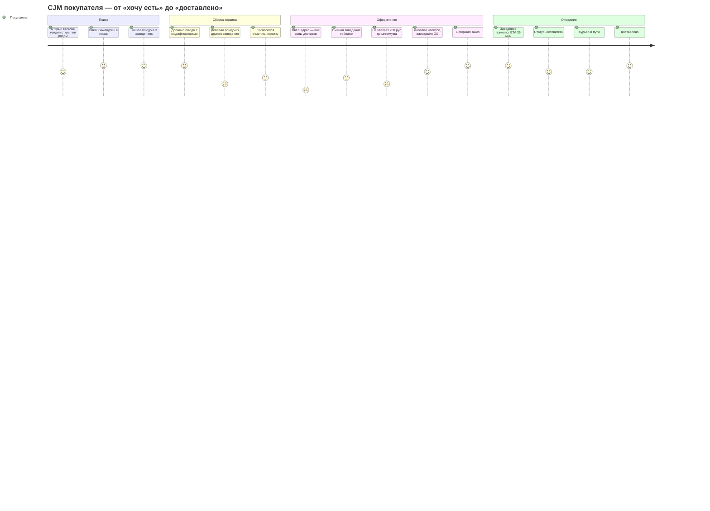

### Сценарии и «трудности» — полный список

Каждая «трудность» — это конкретный код в `issues[]` ответа валидации и конкретный
обработанный кейс в коде, а не абстракция.

| # | Сценарий | Что видит пользователь | Код проблемы | Как решаем |
|---|---|---|---|---|
| U1 | **Happy path** | Заказ создан, статус меняется в реальном времени | — | SSE-поток `/orders/{id}/events` |
| U2 | **Товар кончился, пока лежал в корзине** | «Хинкали недоступны — убрать?» | `ITEM_UNAVAILABLE` | Стоп-лист от POS прилетает в каталог за секунды |
| U3 | **Заведение закрыто** | «Откроется завтра в 10:00» | `VENUE_CLOSED` + `next_open_at` | Расписание с учётом TZ и работы «через полночь» |
| U4 | **Заведение на паузе** (перегружена кухня) | «Заведение временно не принимает заказы» | `VENUE_NOT_ACCEPTING` | Флаг `is_accepting_orders`, переключает само заведение |
| U5 | **Вне зоны доставки** | «Заведение доставляет в радиусе 5 км, вы в 7.2 км» | `OUT_OF_DELIVERY_ZONE` | Расстояние по haversine от точки заведения |
| U6 | **Не набран минимум** | «Добавьте ещё на 240 ₽» | `MIN_ORDER_NOT_MET` | Считаем `missing_minor`, клиент показывает прогресс |
| U7 | **Цена изменилась** | «Цена выросла с 450 до 520 ₽. Продолжить?» | `PRICE_CHANGED` | Храним цену на момент добавления; заказ с `accept_price_changes=true` |
| U8 | **Корзина из двух заведений** | «В корзине блюда из «Хачапури и вино». Очистить?» | `CART_MIXED_VENUES` | Одна активная корзина, привязана к `venue_id` |
| U9 | **Заведение отклонило заказ** | «Заведение не может выполнить заказ: закончились продукты» | — | Компенсация: возврат холда, уведомление |
| U10 | **Заведение не ответило** | «Заведение не подтвердило заказ, деньги не списаны» | — | Temporal-таймер 7 мин → авто-отмена |
| U11 | **Отмена пользователем** | До «готово» — можно, после — нет | `ORDER_NOT_CANCELLABLE` (409) | State machine запрещает переход |
| U12 | **Опечатка в поиске** | «хачапур» → находит «Хачапури по-аджарски» | — | `pg_trgm` similarity как fallback к FTS |
| U13 | **Недоступный модификатор** | «Опция «двойной сыр» недоступна» | `OPTION_UNAVAILABLE` | Стоп-лист на уровне опций |
| U14 | **Холд оплаты не прошёл** | «Оплата не прошла — попробуйте другой способ» | — | Мок отклоняет холд детерминированно (сумма оканчивается на 99 коп.); заказ → `payment_failed`, в POS не уходит |

---

## 3. Сценарии заведения (CJM заведения)

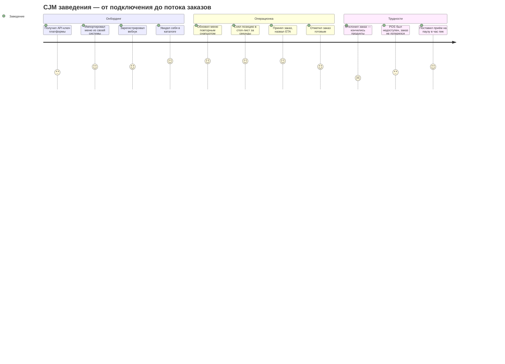

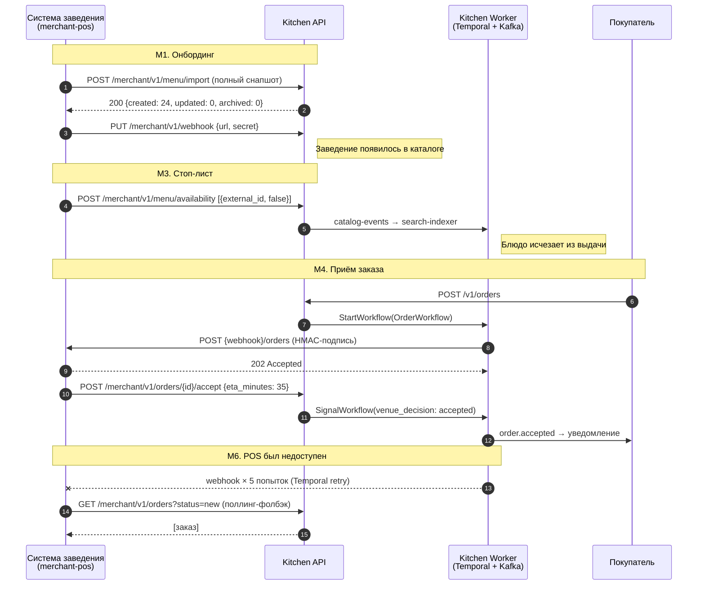

| # | Сценарий заведения | Механика |
|---|---|---|
| M1 | **Онбординг** | Платформа выдаёт API-ключ → POS импортирует меню → регистрирует webhook |
| M2 | **Обновление меню** | Идемпотентный снапшот: diff → `created`/`updated`/`archived`, аудит в `menu_imports` |
| M3 | **Стоп-лист** | Батч-переключение доступности позиций и опций; авто-возврат по таймеру (`StopListWorkflow`) |
| M4 | **Приём заказа** | Webhook → повар видит → `accept` с ETA → `ready` → `delivered` |
| M5 | **Отказ** | `reject` с причиной → компенсация холда → уведомление пользователю |
| M6 | **POS недоступен** | Retry вебхука + поллинг-фолбэк `GET /orders?status=new`; идемпотентность по `order_id` |
| M7 | **Пауза приёма** | `is_accepting_orders=false` — заведение остаётся в каталоге, но помечено |
| M8 | **Витрина статистики** | `GET /merchant/v1/venue/stats` — read-model из Kafka-событий |

---

## 4. Архитектура

### 4.1. C4 Level 1 — Контекст

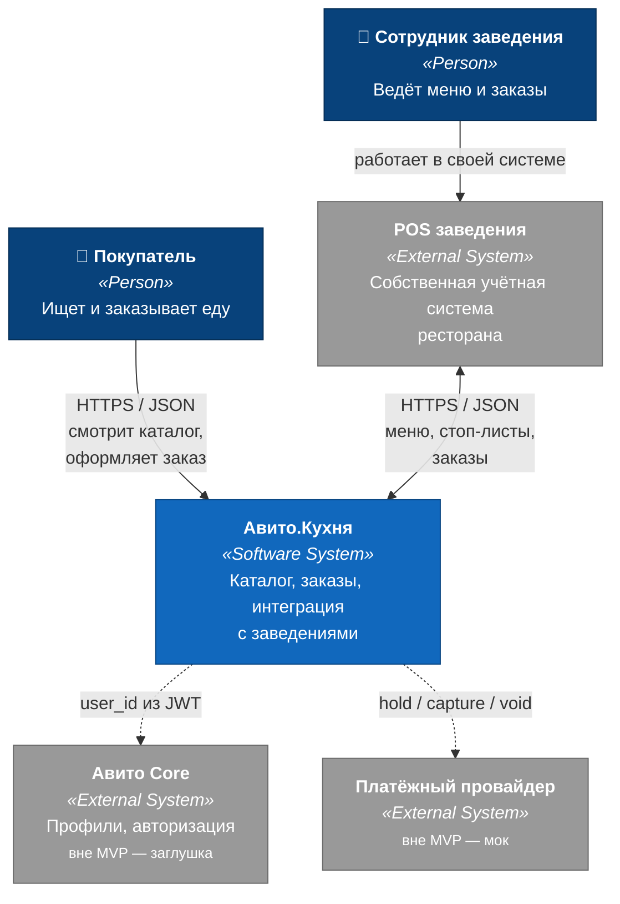

### 4.2. C4 Level 2 — Контейнеры

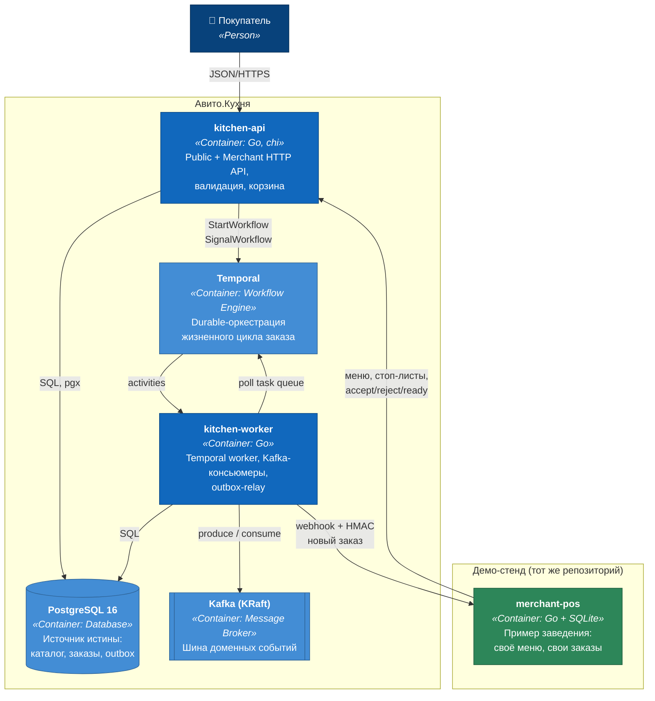

**Почему API и Worker — разные контейнеры.** У них разный профиль нагрузки и разные
причины падать. API обязан отвечать за миллисекунды и масштабируется по RPS; worker
держит долгие соединения с Temporal и Kafka и масштабируется по объёму событий.
Падение worker'а не должно ронять выдачу каталога — заказы просто накапливаются в outbox.

### 4.3. C4 Level 3 — Компоненты `kitchen-api` (модуль заказа)

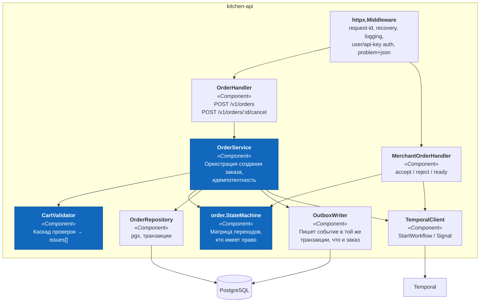

---

## 5. Главный ADR: кто за что отвечает — Postgres, Kafka, Temporal

Это решение, которое придётся защищать на интервью в первую очередь. Правило одно:

> **Postgres — источник истины. Temporal — оркестрация одного процесса.
> Kafka — трансляция фактов подписчикам.**

| | Postgres | Temporal | Kafka |
|---|---|---|---|
| **Ответственность** | Состояние | Процесс | Уведомление |
| **Отвечает на вопрос** | «Какой статус у заказа **сейчас**?» | «Что должно произойти с заказом **дальше**?» | «Кому ещё **интересно**, что произошло?» |
| **Владеет** | Все таблицы, включая `orders.status` | Таймеры, ретраи, компенсации, ожидание сигналов | Фан-аут в поиск, уведомления, витрины |
| **Чтение идёт** | ✅ Всегда отсюда | ❌ Никогда (только дебаг через Query) | ❌ Никогда |

**Как это выглядит на практике.** Статус заказа в `orders.status` — это *проекция*
состояния workflow. Меняет её только activity внутри workflow, читает — HTTP API напрямую
из БД. Так пользовательские запросы не зависят от доступности Temporal, а бизнес-процесс
не зависит от того, кто и как читает статус.

### Почему Temporal, а не «cron + таблица задач»

Жизненный цикл заказа — это именно то, для чего существует durable execution:

- **Долгие таймеры**: 7 минут на подтверждение заведением, SLA готовки, SLA доставки.
- **Ожидание внешних сигналов**: `accept`/`reject` приходят из POS через HTTP-ручку,
  а не по расписанию. Workflow просто ждёт сигнала — без polling-таблицы и без гонок.
- **Компенсации (saga)**: холд оплаты → отмена холда при отказе заведения. Порядок и
  гарантия выполнения компенсации — забота движка, не наша.
- **Тестируемость**: `testsuite.WorkflowTestSuite` прогоняет 7-минутный таймаут за
  миллисекунды. Без Temporal тест «заведение не ответило» пришлось бы писать с `time.Sleep`
  или подменой часов.

Честная альтернатива: `orders` + колонка `next_action_at` + воркер по крону. Работает,
но всю логику таймаутов, ретраев и компенсаций пришлось бы писать и тестировать руками.

### Почему Kafka, а не прямые вызовы

Kafka здесь **не для доставки заказа в POS** — это делает Temporal, потому что ему нужен
*результат* вызова, чтобы двигать процесс. Kafka нужна для наблюдателей, которым результат
не важен и которых со временем становится больше:

- `search-indexer` — обновляет витрину поиска из `catalog-events`
- `notifier` — шлёт пуши пользователю по `order-events`
- `merchant-stats` — считает витрину статистики заведения

Топик `catalog-events` **лог-компактируемый**, поэтому события каталога — всегда полные
снапшоты позиции (fat events), а не дельты: компакция оставляет по ключу только последнее
сообщение, и оно обязано быть самодостаточным. Полный поиск можно пересобрать с нуля
проигрыванием топика. При масштабировании `search-indexer` начнёт писать в Elasticsearch
вместо Postgres — контракт не изменится.

### Дуальная запись: outbox

Событие нельзя опубликовать в Kafka «после коммита» — между коммитом и publish процесс
может умереть. Поэтому:

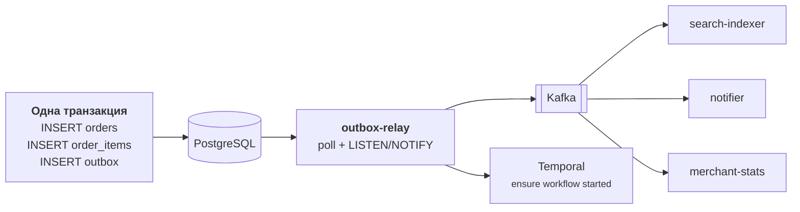

**Двойная страховка на старт workflow.** HTTP-хендлер вызывает `StartWorkflow`
синхронно (быстрый путь, ~5 мс). Если вызов не удался — outbox-relay поднимет запись
`order.created` и вызовет `StartWorkflow` ещё раз. Обе операции идемпотентны, потому что
`WorkflowID = "order-" + orderID`. Дубликат заказа физически невозможен.

**Дедупликация на приёме.** Консьюмеры пишут `event_id` в `processed_events` в той же
транзакции, что и проекцию. Повторная доставка (at-least-once у Kafka — норма) не приводит
к двойному применению.

**Порядок событий.** `outbox.id` — bigserial: при конкурентных транзакциях порядок значений
не совпадает с порядком коммитов, поэтому глобальный порядок публикации не гарантируется —
и не требуется. Гарантирован порядок **per-aggregate**: ключом партиции Kafka служит
`aggregate_id`, события одного заказа или одной позиции меню приходят по порядку.

---

## 6. Жизненный цикл заказа

### 6.1. State machine

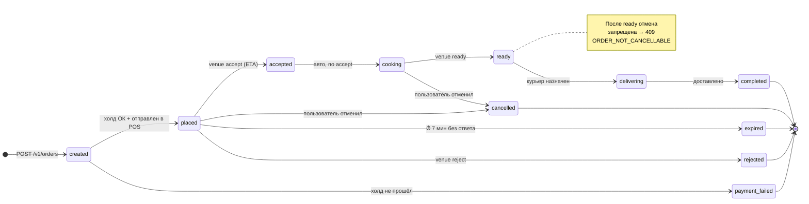

Матрица переходов живёт в `internal/order/domain/statemachine.go` и знает не только
«куда можно», но и **кто имеет право**: `actor ∈ {user, venue, system}`. Попытка заведения
перевести заказ в `cancelled` — ошибка, а не тихий переход. Линтер `exhaustive` следит,
чтобы новый статус не забыли обработать во всех `switch`.

Каждый переход пишется в `order_status_history` — это и аудит, и таймлайн для UI,
и материал для расследования инцидентов.

### 6.2. Temporal `OrderWorkflow`

```mermaid
sequenceDiagram
    autonumber
    participant API as kitchen-api
    participant T as OrderWorkflow<br/>(Temporal)
    participant A as Activities<br/>(kitchen-worker)
    participant POS as merchant-pos
    participant K as Kafka

    API->>T: StartWorkflow(id="order-<uuid>")

    T->>A: AuthorizePayment(hold)
    A-->>T: payment_id
    Note over T: ❌ отказ → status=payment_failed, конец

    T->>A: SendOrderToVenue
    A->>POS: POST {webhook}/orders + HMAC
    Note over A,POS: retry 5× с backoff;<br/>если POS лежит — заберёт поллингом

    T->>A: SetStatus(placed) + Outbox(order.placed)
    A->>K: order.placed

    rect rgb(245, 245, 220)
        Note over T: selector: сигнал ИЛИ таймер
        alt venue_decision = accepted
            POS->>API: POST /merchant/v1/orders/:id/accept
            API->>T: Signal(venue_decision, eta=35)
            T->>A: SetStatus(accepted) → Notify(ETA)
        else venue_decision = rejected
            T->>A: VoidPayment ⟲ компенсация
            T->>A: SetStatus(rejected) → Notify
            Note over T: конец
        else таймер 7 мин
            T->>A: VoidPayment ⟲ компенсация
            T->>A: SetStatus(expired) → Notify
            Note over T: конец
        end
    end

    T->>A: SetStatus(cooking)
    Note over T: таймер SLA готовки → алерт,<br/>но НЕ отмена
    POS->>API: POST /merchant/v1/orders/:id/ready
    API->>T: Signal(order_ready)

    T->>A: AssignCourier (мок) → SetStatus(delivering)
    POS->>API: POST /merchant/v1/orders/:id/delivered
    API->>T: Signal(order_delivered)
    T->>A: CapturePayment → SetStatus(completed)
    A->>K: order.completed
```

**Правила, которые обязательны для Temporal и о них спросят:**

- Внутри workflow нет `time.Now()`, `rand`, прямых HTTP/SQL вызовов — только
  `workflow.Now()`, `workflow.NewTimer`, activities. Иначе ломается детерминизм при replay.
- Все activities идемпотентны: `SetStatus` — проверка текущего статуса перед записью,
  `AuthorizePayment` — по ключу `orderID`.
- Изменения в коде workflow версионируются через `workflow.GetVersion` — иначе
  «в полёте» находящиеся заказы упадут на replay после деплоя.

### 6.3. Второй workflow: `StopListWorkflow`

Заведение ставит блюдо на стоп «до конца дня». Durable-таймер до полуночи в часовом поясе
заведения → активность возвращает блюдо в продажу. Один сигнал `cancel` — если заведение
вернуло блюдо раньше. Двадцать строк кода, а показывает, зачем нужны durable-таймеры,
лучше, чем длинное объяснение.

### 6.4. Cron workflow: `MenuReconciliationWorkflow`

Раз в сутки сверяет витрину платформы с `GET /pos/menu` заведения и логирует дрейф.
Это ответ на вопрос «а что, если событие всё-таки потерялось» — периодическая сверка
дешевле, чем попытка построить exactly-once.

---

## 7. Модель данных

Общие правила схемы:

- **Деньги** — `bigint` в копейках (`*_minor`). Никогда не `float`, никогда не `numeric`
  для арифметики в коде.
- **Идентификаторы** — `uuid` (v7, k-sortable: локальность по времени в B-tree индексе).
- **Enum'ы** — `text` + `CHECK`, а не Postgres `ENUM`: добавить значение в `CHECK` —
  обычная миграция, удалить из `ENUM` — нельзя вовсе.
- **Время** — `timestamptz`, всегда UTC в базе; часовой пояс заведения хранится отдельно
  и применяется при расчёте расписания.
- **Удаление** — мягкое (`is_archived`), потому что на позицию ссылаются исторические заказы.

### 7.1. Заведения и меню

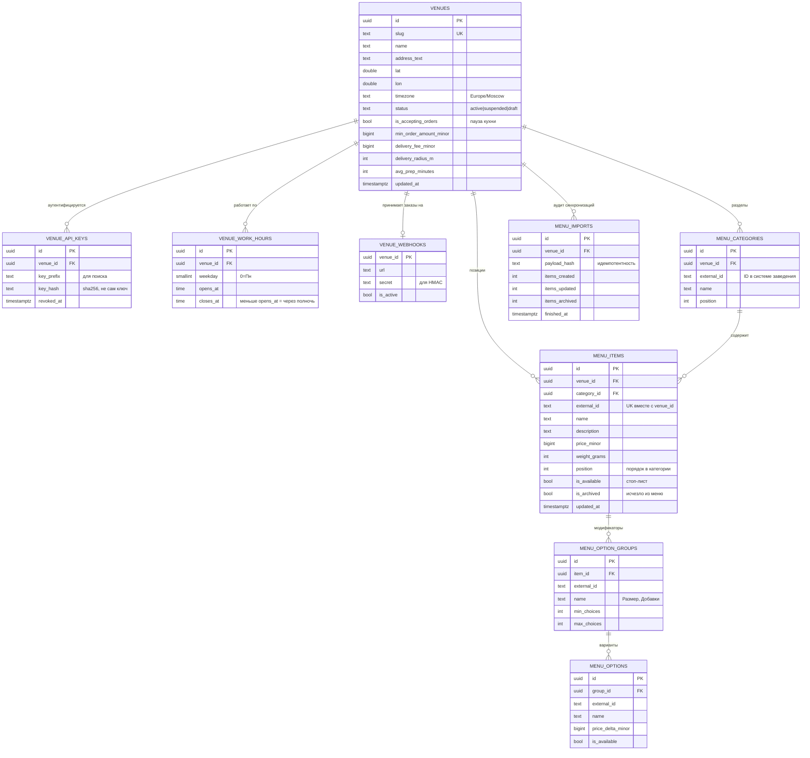

**Ключевое решение — как связать данные платформы с данными заведения.**
`UNIQUE(venue_id, external_id)`. Заведение оперирует **своими** идентификаторами
(артикул из своей 1С/iiko), платформа — своими `uuid`. Связь — составной естественный ключ.
Это значит:

- заведение может слать импорт, не зная про UUID платформы;
- повторный импорт того же снапшота — обновление, а не дубли;
- если заведение переедет на другую CRM и сменит артикулы, мы это увидим как
  «архивировали 24 позиции, создали 24 позиции» в `menu_imports`, а не как тихую порчу данных.

### 7.2. Корзина и заказы

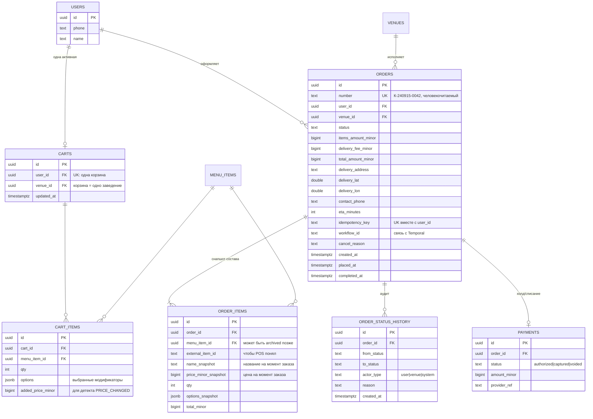

**Почему `order_items` — снапшот, а не ссылка.** Заведение через час поднимет цену или
архивирует позицию. Чек уже выданного заказа меняться не должен — ни для пользователя,
ни для взаиморасчётов. Ссылка `menu_item_id` остаётся для аналитики, но все отображаемые
и денежные поля скопированы в момент оформления. То же и с `external_item_id`: POS должен
получить заказ в своих артикулах, даже если позицию потом удалили.

### 7.3. Инфраструктурные таблицы

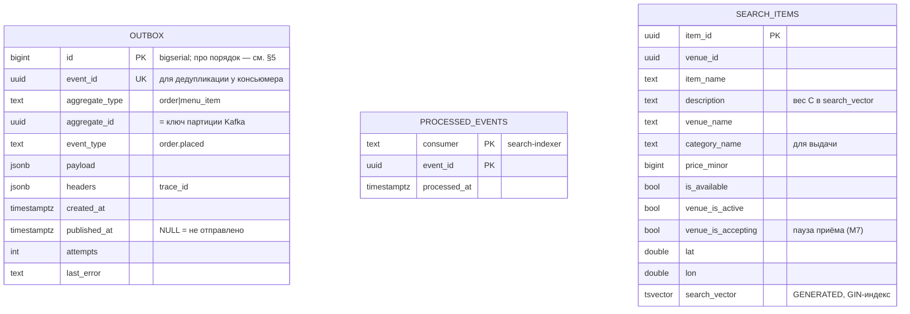

Индексы, которые действительно нужны:

```sql
-- outbox: только неопубликованные, в порядке записи
CREATE INDEX idx_outbox_unpublished ON outbox (id) WHERE published_at IS NULL;

-- поиск: полнотекстовый + опечатки
CREATE INDEX idx_search_vector ON search_items USING GIN (search_vector);
CREATE INDEX idx_search_trgm   ON search_items USING GIN (item_name gin_trgm_ops);

-- лента заказов заведения (поллинг-фолбэк)
CREATE INDEX idx_orders_venue_status ON orders (venue_id, status, created_at DESC);

-- меню заведения
CREATE INDEX idx_items_venue_active ON menu_items (venue_id, category_id, position)
    WHERE NOT is_archived;
```

---

## 8. Состав API

Три спецификации, потому что это три разных контракта с разными владельцами и разным
темпом изменений. `pos-webhooks.openapi.yaml` реализует **заведение**, а не платформа —
держать его в одном файле с нашим API было бы вводящим в заблуждение.

### Public API — `/api/v1`

| Метод | Путь | Назначение |
|---|---|---|
| `GET` | `/venues` | Каталог: `?lat&lon&q&open_now&sort=distance&cursor` |
| `GET` | `/venues/{id}` | Карточка заведения: расписание, минимум, зона |
| `GET` | `/venues/{id}/menu` | Меню по категориям, `?include_unavailable` |
| `GET` | `/search` | **Сквозной поиск блюд** по всем заведениям |
| `GET` | `/cart` | Корзина с пересчитанными ценами |
| `POST` | `/cart/items` | Добавить (`item_id`, `qty`, `options[]`) |
| `PATCH` | `/cart/items/{id}` | Изменить количество |
| `DELETE` | `/cart/items/{id}` · `/cart` | Удалить позицию · очистить |
| `POST` | **`/cart/validate`** | **Каскад проверок → `issues[]`. Клиент зовёт перед показом кнопки «Заказать»** |
| `POST` | `/orders` | Оформить. `Idempotency-Key`, `accept_price_changes` |
| `GET` | `/orders` · `/orders/{id}` | История · карточка с таймлайном |
| `POST` | `/orders/{id}/cancel` | Отмена, если позволяет state machine |
| `GET` | `/orders/{id}/events` | SSE — живой статус для web |

SSE в MVP реализован поллингом `order_status_history` внутри `kitchen-api` (раз в ~2 с
на открытое соединение): без подписки на Kafka в API-процессе и без новой инфраструктуры.
Под нагрузкой заменяется на `LISTEN/NOTIFY` или консьюмер `order-events` — контракт SSE
не меняется.

### Merchant API — `/api/merchant/v1`

| Метод | Путь | Назначение |
|---|---|---|
| `POST` | `/menu/import` | Полный снапшот меню, идемпотентно по хэшу |
| `POST` | `/menu/availability` | **Батч стоп-листа позиций и опций** — самая горячая ручка |
| `GET` | `/orders` | Поллинг-фолбэк: `?status=new&since=&cursor` |
| `GET` | `/orders/{id}` | Карточка заказа |
| `POST` | `/orders/{id}/accept` | Принять, `{eta_minutes}` |
| `POST` | `/orders/{id}/reject` | Отклонить, `{reason}` |
| `POST` | `/orders/{id}/ready` | Готово к выдаче |
| `POST` | `/orders/{id}/delivered` | Доставлено (в MVP курьер замокан) |
| `PUT` | `/venue` | Настройки: пауза, минимум, радиус, расписание |
| `PUT` | `/webhook` | Куда слать заказы + секрет для HMAC |
| `GET` | `/venue/stats` | Витрина: заказов сегодня, выручка, отказы |

### Формат ошибок — RFC 9457 `application/problem+json`

Обычная ошибка:

```json
{
  "type": "https://kitchen.avito.ru/errors/order-not-cancellable",
  "title": "Заказ уже нельзя отменить",
  "status": 409,
  "code": "ORDER_NOT_CANCELLABLE",
  "detail": "Заказ в статусе ready — заведение уже приготовило блюда",
  "instance": "/api/v1/orders/018f.../cancel"
}
```

Ответ валидации корзины — не ошибка, а `200 OK` с диагнозом. Клиент рисует по нему UI:

```json
{
  "is_valid": false,
  "venue_id": "018f...",
  "items_amount_minor": 78000,
  "delivery_fee_minor": 14900,
  "total_amount_minor": 92900,
  "issues": [
    { "code": "ITEM_UNAVAILABLE", "severity": "blocking",
      "item_id": "018f...", "item_name": "Хинкали с бараниной",
      "message": "Закончились" },
    { "code": "PRICE_CHANGED", "severity": "confirmable",
      "item_id": "018f...", "old_price_minor": 45000, "new_price_minor": 52000 },
    { "code": "MIN_ORDER_NOT_MET", "severity": "blocking",
      "min_order_minor": 100000, "missing_minor": 7100 }
  ]
}
```

`severity` — важная деталь: `blocking` гасит кнопку, `confirmable` показывает диалог
«цена выросла, продолжить?» и снимается флагом `accept_price_changes=true`.

### Аутентификация в MVP

| Контур | Механизм | Что будет в проде |
|---|---|---|
| Public | `X-User-Id: <uuid>` (демо-юзеры создаются сидом), middleware резолвит юзера | JWT от Auth-сервиса Авито, `user_id` из claims. **Контракт хендлеров не меняется** — они уже читают user из `context` |
| Merchant | `Authorization: Bearer <key>` → sha256 → `venue_api_keys` | То же + ротация ключей, rate limit по заведению |
| Webhook → POS | `X-Kitchen-Signature: sha256=<hmac(body, secret)>` + `X-Kitchen-Event-Id` + `X-Kitchen-Timestamp` | То же + mTLS |

Изоляция арендаторов: `venue_id` кладётся в контекст middleware'ом и подставляется в
`WHERE` **на уровне репозитория**, а не хендлера. Заведение физически не может прочитать
чужой заказ, даже если хендлер написан с ошибкой.

---

## 9. Поиск и каталог

Пользователь ищет **блюдо**, а не заведение — «хачапури», а не «Хачапури и вино».
Поэтому основная витрина — денормализованная `search_items`.

```sql
-- Полнотекст с русским стеммингом (snowball) + вес: название важнее описания
search_vector tsvector GENERATED ALWAYS AS (
    setweight(to_tsvector('russian', coalesce(item_name, '')),   'A') ||
    setweight(to_tsvector('russian', coalesce(venue_name, '')),  'B') ||
    setweight(to_tsvector('russian', coalesce(description,'')),  'C')
) STORED
```

Запрос: сначала FTS (`@@ websearch_to_tsquery`), если результатов мало — fallback на
`pg_trgm similarity` для опечаток. Ранжирование: `ts_rank * доступность * близость`.
Недоступные позиции не выбрасываются, а опускаются вниз с флагом — пользователю полезно
знать, что блюдо здесь бывает.

**Почему не Elasticsearch.** На объёмах MVP Postgres FTS даёт нужное качество без
пятого контейнера. Витрину наполняет отдельный Kafka-консьюмер — то есть точка
переключения на ES/Manticore уже выделена и изолирована: меняется реализация
`search.Indexer` и `search.Repository`, остальной код не трогается.

---

## 10. Надёжность

| Проблема | Решение |
|---|---|
| Двойное оформление заказа (двойной клик, ретрай сети) | `Idempotency-Key` + `UNIQUE(user_id, idempotency_key)`. Повтор возвращает **тот же** заказ и `200`, а не `201` |
| Потеря события между БД и Kafka | Transactional outbox + relay |
| Дубли при at-least-once доставке | `processed_events(consumer, event_id)` в транзакции проекции |
| POS недоступен | Temporal retry (5 попыток) + поллинг-фолбэк + идемпотентность приёма по `order_id` |
| Заведение не отвечает | Durable-таймер 7 мин → `expired` + компенсация холда |
| Событие не обработалось совсем | DLQ-топик + `MenuReconciliationWorkflow` для сверки |
| Гонка «два accept одновременно» | State machine + `UPDATE ... WHERE status = $expected`, проверка `RowsAffected` |
| Порча данных чужого заведения | `venue_id` из контекста в `WHERE` на уровне репозитория |
| Replay-атака на вебхук | HMAC + timestamp (окно 5 мин) + `event_id` |

---

## 11. Осознанные упрощения

Каждое — сознательное решение с понятной ценой, а не «не успел».

| Упрощение | Почему допустимо в MVP | Чего стоит | Путь наружу |
|---|---|---|---|
| **Нет авторизации** — `X-User-Id` в заголовке | Прямо разрешено заданием | Любой может подставить чужой id | Middleware уже кладёт user в context — замена на JWT не трогает хендлеры |
| **Платежи замоканы** | Нет провайдера и PCI-контура | Не проверена реальная механика холдов | Интерфейс `payments.Provider` с 3 методами — подменяется реализацией |
| **Зона доставки — радиус, не полигон** | Реальные зоны требуют PostGIS и данных | Неточность на границе | PostGIS + `ST_Contains`; схема уже хранит координаты |
| **Курьеры замоканы** | Отдельный домен размером с этот проект | Нет реальных ETA | Отдельный сервис + activity в workflow |
| **Одна активная корзина** | Так работает большинство фудтех-сервисов | Нельзя параллельно собирать два заказа | `UNIQUE(user_id)` → `UNIQUE(user_id, venue_id)` |
| **JSON в Kafka без Schema Registry** | Один продюсер, версия в имени топика | Нет валидации совместимости | Schema Registry + protobuf, топик `.v2` |
| **Outbox через polling, не CDC** | Debezium — отдельный кластер | Задержка до интервала опроса | `LISTEN/NOTIFY` снижает задержку до мс; далее — Debezium |
| **Postgres FTS вместо ES** | Достаточно на объёмах MVP | Нет фасетов, сложного ранжирования | Консьюмер `search-indexer` — уже выделенная точка замены |
| **Один инстанс всего** | Демо-стенд | Нет проверки на конкурентность реплик | Сервисы stateless; outbox-relay нужен `FOR UPDATE SKIP LOCKED` |

---

## 12. Что дальше при масштабировании

1. **Каталог отделяется от заказов** — разный профиль нагрузки (чтение ×1000 против записи).
   Границы уже проведены по модулям `catalog` / `order`.
2. **`search-indexer` переключается на Elasticsearch** — переигрыванием компактируемого
   топика `catalog-events`, без миграции данных.
3. **Outbox-relay заменяется на Debezium CDC** — снимает нагрузку опроса с основной БД.
4. **Шардирование заказов по `venue_id`** — естественный ключ шардирования, заказы
   разных заведений не связаны.
5. **Доставка и оплата выносятся в отдельные сервисы** — в workflow это уже отдельные
   activities, меняется только их реализация.
